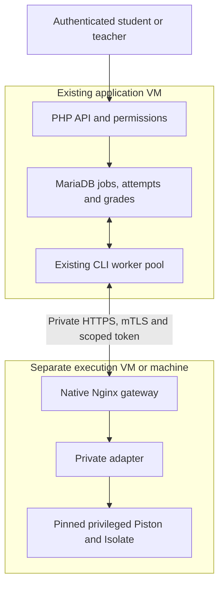

# Phase3G — separate Code Lab execution architecture

Status: independently testable transport/template implementation; **remote host
isolation verification BLOCKED**. No production access, change, restart, migration,
firewall action, provisioning, merge or production load test. R7 remains REQUEST
CHANGES;450-user capacity remains UNVERIFIED.

## Verified source and scope

PR74 was reread open/draft/unmerged at
`aa9b6b35ba86a50024987a60400b13488a9acbb5`. Integration branch
`ecollab-collabs` was fetched unchanged at
`c838359711a14e9b6eb3f345c4386d184a178b25`. This branch starts there, independently
of PR74 and the R7 stack. No migration or authorization service is changed.

Historical user diagnostics identify a2-vCPU/~8GiB application VPS and colocated
privilegedPiston without user remapping/AppArmor isolation. Those are historical
runtime observations, not a new host inspection. Code confirms privileged mode,
private cgroup namespace, one CPU/1536MiB/256PIDs, an unpublished Piston listener,
loopback adapter2358, pinned Piston image and mutable legacy Python image tag.
Production deployment/version/network state was not reverified this phase.

## Current execution path and trust boundaries

1. `API/code-lab/index.php` authenticates the PHP session, verifies CSRF for writes
   and delegates to `CodeLabService` / `CodeLabExecutionService`. Server membership,
   student/teacher roles, deadlines, optimistic saves and private ownership remain
   application-side decisions. The browser receives no runner credentials.
2. `CodeLabService::save` freezes the submitted attempt and enqueues its automatic
   grade in one transaction.054 defines classroom records;055 defines cases,
   job persistence and UNIQUE(attempt_id);062 provides the durable server-round-
   robin cursor. Playground jobs are similarly bounded/per-user gated.
3. `scripts/code-lab-worker.php` forks the existing bounded pool before opening
   connections. `CodeLabWorkerPool` uses per-slot database locks.
   `CodeLabExecutionService::claim` briefly serializes dispatch through the cursor,
   then releases the transaction before remote compilation. The application
   remains responsible for result ownership, infrastructure failures, atomic grade
   persistence, manual overrides and similarity-related integration.
4. `CodeLabRunner` sends a server-chosen runtime ID/source/stdin through a Judge0-
   subset API. It cannot accept a browser-selected URL. Adapter jobs are opaque
   UUIDs, bounded in-memory queues/results; they are not the authoritative grade
   store. The PHP worker polls, decodes bounded output and never executes source.
5. `bridge.py` maps fixed IDs to frozen language/version/filename profiles and
   sends fixed execution envelopes to private Piston. Source is not evaluated or
   passed to subprocess/shell by the Python adapter. Callback URLs, arbitrary
   command/compiler arguments, additional files and caller-raised limits are not
   honored. `prepare.py` is a trusted package bootstrap, not a submission path.
6. Piston/Isolate creates namespaces/chroot/users/cgroups. Trusted grading patches
   `grading/install.py`, `route.js`, `job-method.js` compile once, snapshot bounded
   regular artifacts without links, then create fresh case boxes and clean them.
   JavaScript and legacyJava retain their existing per-case fallback; batch C,
   C++,Python and compiledJava capabilities are unchanged.
7. Case inputs necessarily reach the execution system; **expected outputs do not**.
   `workOne` compares outputs locally, returns only case pass/fail metadata to
   students and strips grading stdout/stderr/compiler diagnostics that could echo
   hidden inputs. It atomically stores job result and automatic score. Runner
   failure marks the job failed without automatically recording zero marks.

Current critical boundary failure: all these namespaces still share the
application host kernel. Privileged-container compromise can undermine host
filesystem/network/control-plane isolation. Loopback2358 and container quotas do
not establish independent kernel isolation.

## Proposed topology — not a deployed diagram

Only bounded execution responses return along the request path. The execution
host gets no DB/application/storage/admin credentials and no ability to initiate
connections into application networks. The last network property requires an
**external** stateful ACL or equivalent independently enforced boundary, not a
firewall editable by a compromised execution guest. Host administrators keep SSH
private keys and CA signing keys off the execution machine; no agent forwarding.
A scoped gateway server key and adapter token are service credentials, not shared
application/admin authority. A compromised runner can still lie about results;
transport authentication is not attestation of grading correctness.

## Confirmed findings and implementation

| Finding | Evidence | Response |
|---|---|---|
| P0 release blocker: privileged execution on application kernel | `deploy/code-lab/piston/compose.yml`, servicepiston; historical runtime diagnostics | Separate guest/machine boundary required; deployment proof BLOCKED |
| Plain private HTTP is currently permitted | `CodeLabRunner::__construct/request` | Opt-in strict `CODE_LAB_RUNNER_TRANSPORT=mtls`; no plaintext/certificate-error fallback in that mode |
| Source-bearing internal HTTP could follow redirects/use inherited proxies | `bridge.py::piston_request` previously used default urllib opener | Fixed approved paths and same-execution-host destinations; explicit no-proxy/no-redirect opener |
| Legacy adapter image is a mutable tag | existing Compose adapterimage | Staging overlay pins official Python image to registry-verified digest |
| Per-file limits do not bound total scratch | Piston config and legacy/tmp tmpfs | Overlay adds512MiB tmpfs at actual Isolate root; CI must verify root/mount, not assume path |
| Bootstrap chooses newest packages on first preparation | `prepare.py::prepare` | Preserve exact existing profiles/artifact hashes before cutover; supply-chain provenance remains a release gate |
| Adapter jobs/results disappear on restart | `Adapter.jobs` is in memory | Persistent app queue/attempts retained; outage and adapter-restart retry tested; no exactly-once execution claim |

### Strict transport

`CodeLabRunner::request` in mTLS mode requires HTTPS, a bearer token of at least32
characters, local readable CA/certificate/key files and a non-world-accessible key.
cURL explicitly verifies peer and hostname, uses TLS1.2 or newer and permits HTTPS
only. Existing3-second connect/12-second request deadlines, response cap and
redirect/proxy denial remain. Invalid/unavailable transport throws the existing
infrastructure failure; there is no silent resubmission or fallback URL.

Credential I/O is deliberately **deferred to an actual worker request**. Task
creation/start/save and deadline submission must not require PHP-FPM to read the
worker's private key or contact the runner. The queue fixture persists an immutable
automatic submission while the configured worker key is missing, then verifies
failed execution has no zero score and retry completes the same job. A mistakenly
eager constructor check was corrected before publication to preserve this property.
Legacy mode remains the default for backward compatibility. Merely merging this
code does not relocate or secure a deployed runner; staging must select mTLS mode
and the gateway must independently require client authentication.

### Execution-host staging templates

`compose.isolated.yml` applies over the existing Compose file on a **separate**
execution machine: internal-only network, explicit disabled sandbox networking,
bounded Isolate scratch, retained CPU/RAM/PID/output/time limits. It retains
privileged mode because unprivileged Piston compatibility has not been established.
The Piston image digest and existing runtime mappings are not changed.

Adapter image pin, obtained from the official Docker registry and matched against
the SHA256 of its OCI manifest bytes on2026-10-23:
`python@sha256:6a0e06f5ba0b373d051aabd3fffb9b873f27f9a2a3a14bcbe37dee6f0e3bbc70`.
Pinning prevents silent tag drift; it does not certify the image or runtime
packages free of vulnerabilities. Bootstrap artifacts still need provenance/CVE
review. The legacy Compose tag remains unchanged outside the opt-in overlay.

`deploy/code-lab/isolated/nginx.conf.example` is a native private-interface gateway
with mandatory dedicated-client-CA authentication and CRL verification; TLS session
resumption and HTTP keepalive are disabled. Each new request rechecks TLS
credentials; this does not establish an instantaneous in-flight revocation SLA.
It forwards only the existing language/submission/grading
routes to the adapter's reviewed private Docker bridge address on2358; neither
container publishes ports. `execution.env.example` requires an unused private
subnet and adapter address. The native Linux gateway reaches that address
directly. Compose must support `!reset` to remove inherited ports; staging
requires reviewed Compose2.24.4+. Package-management routes are not exposed. It bounds
connections/body/deadlines, forbids upstream failover, and logs no raw requests,
source, credentials or result tokens. `application.env.example` contains paths and
placeholders only; no production or generated private keys are committed.
No automatic host/firewall/overlay installer or systemd change is included.

## Threat model and guarantees

| Threat | Protection / honest limit |
|---|---|
| Isolate or container escape | Dedicated execution guest contains the intended blast radius to that guest; guest/kernel/provider separation remains unverified. Docker itself is not the independent boundary. |
| Privileged guest compromise | Can defeat local Docker networking/limits, read runner inputs and scoped service keys, and fabricate results. External ACL and absence of reusable admin/DB/app secrets are required. Rebuild/revoke after suspected compromise. |
| Application filesystem/DB access | No mounts or credentials; return data accepted only through existing worker validation/persistence. Actual external reachability denial must be proved on staging. |
| Other students' data / hidden cases | Separate boxes and fresh case artifacts protect ordinary submissions; output filtering keeps hidden data from HTTP results. A compromised execution kernel may read concurrent code/inputs. Stronger per-job VM isolation is not implemented or claimed. |
| CPU/memory/process/output exhaustion | Existing limits retained; bounded resource probes in disposable real CI. Host/vCPU/disk containment must be enforced outside a compromised guest. No production capacity guarantee. |
| Disk exhaustion | Per-file cap plus bounded total job scratch and bounded logs; package volumes require monitored disk quotas/space and trusted updates. Do not confuse one-file limits with total disk limits. |
| Outbound networking / SSRF | Isolate default denial, internal Docker network, no redirect/proxy routing and no callbacks; independent host/provider egress deny remains a release gate. No production network was probed. |
| Abandoned/duplicate work | Existing worker timeout/recovery, unique attempt-job constraint and guarded grade commit retained. Network ambiguity can repeat sandbox execution on explicit retry; exactly-once execution is not promised. |
| Malformed/flooded results | Existing JSON/base64/type/status/output caps and bounded gateway/adapter requests retained. No remote shell, HTML rendering or direct DB callback is added. |
| Compromised runtime packages | Frozen IDs/versions, pinned images, reviewed artifact hashes and offline preparation required. Version labels alone do not prove package integrity. |

Piston documents Isolate namespaces/chroot/users/cgroups and default network denial:
https://github.com/engineer-man/piston/blob/master/readme.md
Current upstream configuration reference:
https://github.com/engineer-man/piston/blob/master/api/src/config.js
These references explain the model; actual CI uses the existing pinned image,
not an unpinned checkout of upstreammaster. Safe routine probes are not proof that
no container/kernel escape exists.

## Architecture/resource/cost comparison

All specifications below are modeled starting points, **not measured sizing or
approved purchases**. Current trustworthy recurring prices were not obtained;
pricing is NOT VERIFIED rather than fabricated. No resources were ordered.

| Option | Security boundary | Candidate resources / network | Operational cost and compatibility |
|---|---|---|---|
| Dedicated execution VPS/VM | Independent guest kernel from app; privileged escape still compromises that guest | Model2vCPU/4GiBRAM/30GiBdisk; retain current1CPU/1536MiB Piston quota and existing1–2 slots pending measurements; private mTLS + external ACL | Additional provider charge, price unavailable. Practical first staging candidate. Same Piston/API/runtime model; no appDB access. |
| Separate existing worker machine | Separate physical/guest kernel, provided it is not the app host | At least the same measured-to-be-validated envelope; private overlay may be needed across NAT, without production subnet routing | May reuse equipment but uptime, power, NAT and admin overhead remain unknown. WAN latency/failures must be measured. No automatic VPN installation. |
| Per-job hypervisor-backed sandbox | Potential independent kernel per job and stronger cross-student containment | Requires verified KVM/hypervisor support, guest images, networking, cleanup and runtime compatibility | Higher engineering/operations cost, price unavailable. Firecracker/Kata not deployed or certified; no compatibility claim. |
| More Docker hardening on app host | Same kernel; insufficient for the stated boundary | Existing quotas, internal network, reduced adapter privileges useful as defense in depth | Low incremental config cost, but **rejected as sole isolation**. Do not assume privileged=false works. |

Firecracker requires access to `/dev/kvm`; a hosting plan named KVM does not prove
nested virtualization is available:
https://github.com/firecracker-microvm/firecracker/blob/main/docs/getting-started.md
No KVM/device/provider capability inspection or microVM benchmark was performed.

Moving execution can reduce app contention only after actual relocation; it has
not happened here. Worker count, PHP-FPM baseline, quotas, admission fairness,
submission limits, UI, similarity integration and database schema are unchanged.
Expected throughput depends on measured service time, not registered-user count;
measure cold/hot compilation, batch size, deadlines and queue arrivals separately.

## Test matrix and measurements

Local: actual Nginx1.24 + PHP8.3 cURL, ephemeral distinct server/client CAs, client
certificates/CRL, real adapter, mocked Piston backend. **No source code is executed
by that local backend.** Its transport timing is not language execution capacity.
No Docker daemon or separately authorized execution VM is available locally.

| Requirement | Evidence / scope |
|---|---|
| Authentication and correct caller | Actual mTLS and scoped token pass; wrong/missing/foreign/revoked client, wrong serverCA/hostname, wrong bearer, plaintext, missing/world-accessible key and invalid mode denied |
| Rotation | Actual CRL update and fixture gateway restart reject old credential; new scoped certificate works; no instant in-flight revocation SLA claimed |
| Queue outage/restart/retry | Actual cURL outage through `CodeLabExecutionService` + SQLite fixture; submission survives missing worker key, no automatic zero, same job/immutable source, hidden filtering and no duplicate grade; real adapter restarted during recovery |
| Protocol/functionality | Existing adapter, PHP execution/batch, worker-pool, server fairness and artifact snapshot regressions retained; no tests suppressed |
| Five runtime categories and both Java profiles | Real pinned Docker CI smoke tests; local compiler execution NOT RUN |
| Compile-once grading / pristine cases | Existing real CI tests and local artifact/protocol regressions retained |
| Memory/process/file/output/CPU/network limits | Harmless bounded probes in owned CI only; memory allocation capped300MiB, nonrecursive fork attempts capped80, file write capped12MiB. No exploits or production stress test. |
| Filesystem confinement | Real CI container-host canary plus existing profile-file visibility and cross-job/case checks; no formal escape proof |
| Effective Docker boundary | CI checks actual network inspect, ports, mounts, image pins, quotas, scratch mount and actual Isolate root path; still one CI machine |
| Private management and safe routing | Actual gateway rejects package-management path; real internal backend tests reject redirects, inherited proxies and unapproved URL/path |
| Independent execution-host/appDB/external network isolation | **BLOCKED**, no authorized remote infrastructure/probes |
| Runtime package migration/provenance | **BLOCKED** until exact existing profiles/artifacts are audited and matched; no production package volume inspected |

The mTLS fixture records12 authenticated GET/languages timings per mTLS/direct-
adapter HTTP path and one known
Python-source request. Mock backend CPU is recorded as unavailable, not measured.
Actual runtime CPU comes only from an actual backend response when CI uses Piston;
memory, hostCPU/RAM, queue-wait time and mixed resource contention remain unmeasured
when telemetry is absent. Do not substitute zero for unavailable data. See
`450-phase3g-evidence.json` for local observations; exact-head CI and actual runtime
measurements are linked in the draft PR after jobs complete.

Local PHPUnit Unit passes25tests/56assertions. The existing11adapter tests,
PHP execution/batch/pool/server-queue regressions, artifact snapshots and private
backend routing tests also pass.

Local fixture setup initially exposed Nginx regex quoting and sandbox-specific
temporary path/user requirements. Those test/configuration issues were corrected
before the final run. These are not production measurements. Test certificates
are generated only inside a private temporary directory and removed; no key or
raw submitted program/result is stored in the report.

## Staging rollout, recovery and secure rollback

The concrete checklist is `deploy/code-lab/isolated/README.md`. Before activation,
prove the separate VM/host boundary and effective IPv4/IPv6/Docker exposure from an
independent client. Application DB/admin/collaboration services must be unreachable
from execution guests, including metadata/link-local endpoints and alternate
routes. Use controlled staging canaries, not production port scans or exploits.
Private addressing, TLS and successful compilers individually do not prove this.

Prepare images/packages/profiles separately; preserve old runtime versions and
IDs. Existing `setup-code-lab-piston.sh` is a colocated legacy installer and must
not be used to copy application configuration onto the execution host. Restrict
management to trusted operator access. Freeze artifacts before default-deny
egress; monitor scratch/disk, queue age, callback/request errors, compiler status,
certificate/CRL expiry, resource use, orphan work and recovery. Never log source,
hidden inputs, tokens or private keys. Sanitized aggregate metrics remain needed.

For cutover/rotation, keep immutable submission persistence available, pause new
worker claims through a reviewed drain and preserve queued work. Adapter state is
volatile; ambiguous/aborted requests must be handled as infrastructure failures
and retried through existing permissions/deduplication, never scored zero or
silently discarded. A dedicated adapter drain-status endpoint is not implemented;
obtain evidence of no remaining in-flight/orphan jobs before planned restart.

Rollback must retain independent execution: restore an approved remote release
and frozen profiles, or leave execution claims paused while retaining submissions
and grades. Do not fall back to privileged execution on the app VPS, remove TLS
checks, reset the database, delete queued jobs or alter worker counts. Suspected
execution compromise requires rebuilding that boundary and rotating its scoped
credentials, not trusting its previous result cache.

Final verdicts: transport implementation testable; repository functionality
regressions subject to exact-head CI; **Code Lab remote isolation BLOCKED** pending
actual independent-host/network/package proof and accepted cross-student threat
model. R7 remains REQUEST CHANGES.450-user capacity remains UNVERIFIED.

## Initial CI defect and correction

At initial head `5771967f4e436ec97b312ad2275648d9632dc951`, the protocol job
passed, but real sandbox CI failed readiness because the inherited published
loopback port was unreachable on the internal Docker network. This was an
introduced configuration failure, not a successful runtime test. The correction
removes port publication and routes the native gateway directly to a configured
private adapter bridge address. Internal-only networking remains enforced and
all real compiler/resource tests remain enabled. Exact corrected-head outcomes
are reported in PR75; independent-host evidence remains BLOCKED.

Docker references: [internal networking and host reachability](https://docs.docker.com/engine/network/port-publishing/)
and [Compose merge/reset semantics](https://docs.docker.com/reference/compose-file/merge/).
